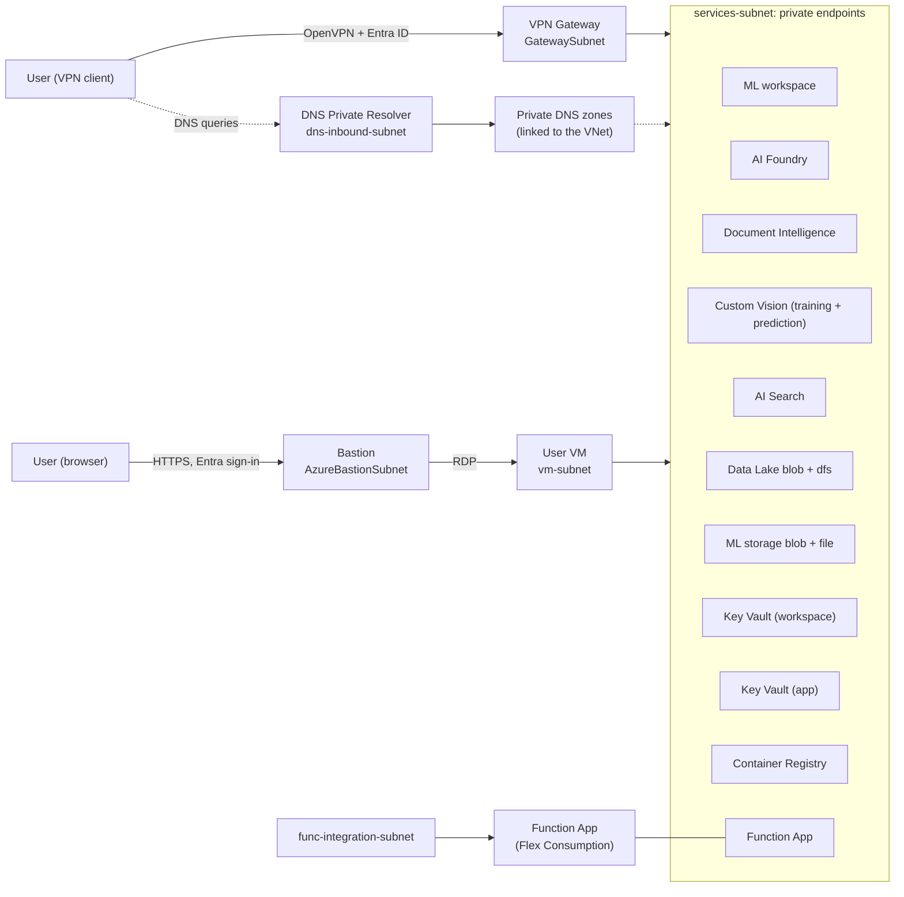

# Architecture

A private-only Azure environment for an AI engineering team. Every PaaS service has public network access disabled. Users reach them either over a Point-to-Site VPN with Microsoft Entra ID authentication, where names resolve to private IPs through an Azure DNS Private Resolver, or through Azure Bastion into VMs inside the network. `ACCESS_MODE` chooses VPN, Bastion or both. See [accessing-the-environment.md](accessing-the-environment.md).

Environment-specific values (resource names, private IPs, portal links, VPN profile) are not listed here. Run `./scripts/deploy.ps1 -Step 6` to print them.

## Overview

The VPN path exists with `ACCESS_MODE` `vpn` or `both`, and the Bastion path with `bastion` or `both`.

## Services and private connectivity

| Service | Private endpoint sub-resource | Private DNS zone(s) |
|---|---|---|
| Azure Machine Learning workspace | `amlworkspace` | `privatelink.api.azureml.ms`, `privatelink.notebooks.azure.net` |
| AI Foundry (AI Services / Azure OpenAI) | `account` | `privatelink.openai.azure.com`, `privatelink.cognitiveservices.azure.com`, `privatelink.services.ai.azure.com` |
| AI Search | `searchService` | `privatelink.search.windows.net` |
| Document Intelligence | `account` | `privatelink.cognitiveservices.azure.com` |
| Custom Vision, training and prediction (two accounts) | `account` | `privatelink.cognitiveservices.azure.com` |
| Data Lake (ADLS Gen2) | `blob`, `dfs` | `privatelink.blob.core.windows.net`, `privatelink.dfs.core.windows.net` |
| ML default storage (also holds the Function deployment package) | `blob`, `file` | `privatelink.blob.core.windows.net`, `privatelink.file.core.windows.net` |
| Key Vault (ML workspace) | `vault` | `privatelink.vaultcore.azure.net` |
| Key Vault (application and team secrets) | `vault` | `privatelink.vaultcore.azure.net` |
| Container Registry (Premium) | `registry` | `privatelink.azurecr.io` |
| Function App (Flex Consumption) | `sites` | `privatelink.azurewebsites.net` |

Private endpoints give users inside the VNet (including VPN clients) a private path into each service. They do not by themselves connect services to each other. Service-to-service access, for example Search indexing the Data Lake, is not configured and needs shared private links or trusted-service access plus roles.

## Network

| Subnet | Default range | Purpose |
|---|---|---|
| `services-subnet` | `10.0.1.0/24` | Private endpoints |
| `GatewaySubnet` | `10.0.2.0/24` | VPN Gateway only |
| `dns-inbound-subnet` | `10.0.3.0/28` | DNS Private Resolver inbound endpoint (delegated) |
| `func-integration-subnet` | `10.0.4.0/24` | Function App VNet integration (delegated, required by Flex Consumption) |
| `AzureBastionSubnet` | `10.0.5.0/26` | Azure Bastion. Only with `bastion` or `both`. A network security group with the rules Bastion requires is attached |
| `vm-subnet` | `10.0.6.0/24` | The per-user VMs. Only with `bastion` or `both` |

The VNet address space is `10.0.0.0/16`. With VPN access the resolver inbound endpoint uses the first usable address of its subnet (`10.0.3.4`) and is set as the VNet DNS server, so VPN clients receive it in their profile. Ranges are set in `.env`.

## Access layer (step 5)

- **VPN** (`vpn` or `both`): a VPN Gateway (Point-to-Site, OpenVPN, Entra ID sign-in) and a DNS Private Resolver, so a connected computer resolves private names to private addresses.
- **Bastion** (`bastion` or `both`): an Azure Bastion host and one Windows Server 2022 VM per user (`VM_COUNT`). A user opens their VM in the Azure portal, connects through Bastion with the VM's local username and password, and works from there. Each VM has a system-assigned identity with Virtual Machine Contributor on itself only, so it can deallocate itself. Each VM also gets a daily shutdown schedule and an idle shutdown task, and a run command installs Git, Python, VS Code and the Azure CLI. Failures in that run command are logged to `C:\ProvisionTools.log` and never fail the deployment. The installers are downloaded over HTTPS and are not checksum-verified, and the script turns off Internet Explorer's enhanced security mode for administrators so the VMs can browse.

## Two Key Vaults

- **Workspace vault:** used only by the Azure ML workspace for its internal secrets. Only admins get access.
- **Application vault:** for team and application secrets. Developers can read and write. The Function App's managed identity has Key Vault Secrets User, so it can use Key Vault references.

## Design decisions

- **Fourth subnet.** The services, gateway and DNS resolver subnets are not enough. Flex Consumption VNet integration needs its own subnet delegated to `Microsoft.App/environments`, and a private endpoint subnet cannot be shared with it, so `func-integration-subnet` exists.
- **Separate storage for Azure ML.** Azure ML does not support a hierarchical-namespace (Data Lake) account as its default storage, so the workspace uses its own standard account. The Function App's deployment package (`app-package` container) lives there too.
- **AI Foundry uses the AI Services account kind.** It serves both Azure OpenAI and the Foundry APIs. That adds two DNS zones beyond the OpenAI one (`cognitiveservices` and `services.ai`).
- **Document Intelligence and Custom Vision are separate accounts.** Each has its own endpoint, private endpoint and keys, even though the AI Services account also exposes document features. Document Intelligence is the `FormRecognizer` kind. Custom Vision needs two accounts, one for training (`CustomVision.Training`) and one for prediction (`CustomVision.Prediction`). All three reuse the `cognitiveservices` DNS zone and are deployed through `infra/modules/cognitive-account.bicep`.
- **Custom Vision is being retired.** Microsoft will support it until 25 September 2028 and recommends Azure ML AutoML or Foundry models for new work. It is included for teams that still use it.
- **Extra DNS zones.** `privatelink.notebooks.azure.net` (ML notebooks) and `privatelink.file.core.windows.net` (ML storage file share) are required by Azure ML.
- **Azure ML network mode.** The workspace uses a managed network in `AllowInternetOutbound` mode. Public access to the workspace itself is disabled.
- **Resolver as VNet DNS.** With VPN access, the DNS Private Resolver inbound endpoint is a static address and is also set as the VNet DNS server, so VPN clients receive it in their profile. Step 5 deploys step 1 a second time to set it.
- **AI Search tier.** Search is deployed as `basic`, the cheapest tier that supports private endpoints. An existing search service cannot change SKU in place, so changing the tier later means recreating it.
- **Names.** Every name follows `<type>-<purpose>-<prefix>`, with a hash suffix derived from the resource group ID only where Azure needs a globally unique name. They are stable across redeployments. See [deployment.md](deployment.md#naming) and `infra/names.bicep`.
- **Subscription-added resources.** Some subscriptions add resources through Azure Policy or Defender, for example empty network security groups on subnets and Event Grid system topics on storage accounts. They are not created by these templates and have no custom rules.

## Security baseline

- Public network access disabled on every PaaS service.
- Storage: shared key access off, blob public access off, TLS 1.2 minimum.
- Key Vault: RBAC authorization, soft delete, purge protection.
- AI Services, Document Intelligence and AI Search: key authentication disabled (Entra ID only).
- Custom Vision: key authentication is left on, because Entra support for its API was not verified. Public network access is still disabled, so keys only work from inside the network.
- Container Registry: admin user off.
- Function App: HTTPS only, identity-based storage access.
- Azure ML: system-assigned identity, identity-based datastores.
- Access is granted to Entra groups. See [rbac.md](rbac.md).
- Bastion VMs: local password per VM (generated, 24 characters), so there is no MFA at the VM sign-in. Each VM can manage only itself.

## Not included

- Model deployments and Foundry projects.
- Service-to-service private connectivity.
- Custom network security group rules on the service subnets. Only the Bastion subnet has an NSG from these templates. Empty NSGs on other subnets, if any, come from the subscription.
- Azure Monitor Private Link Scope (Application Insights accepts public ingestion).

## Deployment order

| Step | File | Contents |
|---|---|---|
| 1 | `infra/01-network.bicep` | VNet, subnets, private DNS zones and links |
| 2 | `infra/02-storage-keyvault.bicep` | Data Lake, both Key Vaults, private endpoints |
| 3 | `infra/03-ai-ml.bicep` | Container Registry, Search, AI Foundry, Azure ML, Function App, private endpoints |
| 4 | `infra/04-rbac.bicep` | Entra groups and role assignments |
| 5 | `infra/05-access-vpn.bicep`, `infra/05-access-bastion.bicep` | Access layer chosen by `ACCESS_MODE`. VPN: DNS Private Resolver and VPN Gateway, then step 1 again to set VNet DNS. Bastion: step 1 again to add the Bastion and VM subnets, then Bastion and the VMs |
| 6 | (script) | Summary: portal links, private endpoint IPs, connection details for the chosen access mode |

See [README.md](../README.md) for how to run them and [vpn-client-setup.md](vpn-client-setup.md) for connecting.
