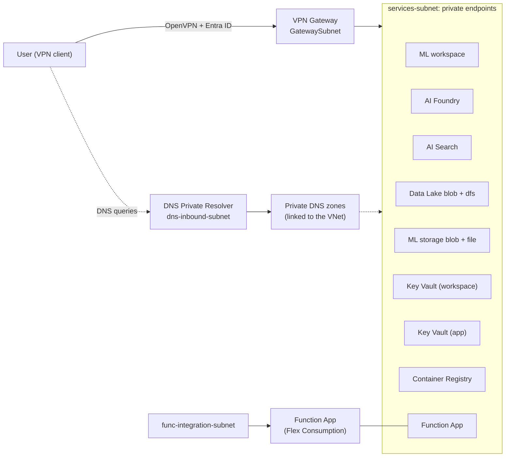

# Architecture

A private-only Azure environment for an AI engineering team. Every PaaS service has public network access disabled. Users reach them over a Point-to-Site VPN with Microsoft Entra ID authentication, and names resolve to private IPs through an Azure DNS Private Resolver.

Environment-specific values (resource names, private IPs, portal links, VPN profile) are not listed here. Run `./scripts/deploy.ps1 -Step 6` to print them.

## Overview

## Services and private connectivity

| Service | Private endpoint sub-resource | Private DNS zone(s) |
|---|---|---|
| Azure Machine Learning workspace | `amlworkspace` | `privatelink.api.azureml.ms`, `privatelink.notebooks.azure.net` |
| AI Foundry (AI Services / Azure OpenAI) | `account` | `privatelink.openai.azure.com`, `privatelink.cognitiveservices.azure.com`, `privatelink.services.ai.azure.com` |
| AI Search | `searchService` | `privatelink.search.windows.net` |
| Data Lake (ADLS Gen2) | `blob`, `dfs` | `privatelink.blob.core.windows.net`, `privatelink.dfs.core.windows.net` |
| ML default storage (also holds the Function deployment package) | `blob`, `file` | `privatelink.blob.core.windows.net`, `privatelink.file.core.windows.net` |
| Key Vault (ML workspace) | `vault` | `privatelink.vaultcore.azure.net` |
| Key Vault (application and team secrets) | `vault` | `privatelink.vaultcore.azure.net` |
| Container Registry (Premium) | `registry` | `privatelink.azurecr.io` |
| Function App (Flex Consumption) | `sites` | `privatelink.azurewebsites.net` |

Private endpoints give users inside the VNet (including VPN clients) a private path into each service. They do not by themselves connect services to each other. Service-to-service access, for example Search indexing the Data Lake, is not configured and needs shared private links or trusted-service access plus roles.

## Network

| Subnet | Default range | Purpose |
|---|---|---|
| `services-subnet` | `10.0.1.0/24` | Private endpoints |
| `GatewaySubnet` | `10.0.2.0/24` | VPN Gateway only |
| `dns-inbound-subnet` | `10.0.3.0/28` | DNS Private Resolver inbound endpoint (delegated) |
| `func-integration-subnet` | `10.0.4.0/24` | Function App VNet integration (delegated, required by Flex Consumption) |

The VNet address space is `10.0.0.0/16`. The resolver inbound endpoint uses the first usable address of its subnet (`10.0.3.4`) and is set as the VNet DNS server, so VPN clients receive it in their profile. Ranges are set in `.env`.

## Two Key Vaults

- **Workspace vault:** used only by the Azure ML workspace for its internal secrets. Only admins get access.
- **Application vault:** for team and application secrets. Developers can read and write. The Function App's managed identity has Key Vault Secrets User, so it can use Key Vault references.

## Design decisions

- **Fourth subnet.** The brief called for three subnets. Flex Consumption VNet integration needs its own subnet delegated to `Microsoft.App/environments`, and a private endpoint subnet cannot be shared with it, so `func-integration-subnet` was added.
- **Separate storage for Azure ML.** Azure ML does not support a hierarchical-namespace (Data Lake) account as its default storage, so the workspace uses its own standard account. The Function App's deployment package (`app-package` container) lives there too.
- **AI Foundry uses the AI Services account kind.** It serves both Azure OpenAI and the Foundry APIs. That adds two DNS zones beyond the OpenAI one (`cognitiveservices` and `services.ai`).
- **Extra DNS zones.** `privatelink.notebooks.azure.net` (ML notebooks) and `privatelink.file.core.windows.net` (ML storage file share) are required by Azure ML and were added to the list in the brief.
- **Azure ML network mode.** The workspace uses a managed network in `AllowInternetOutbound` mode. Public access to the workspace itself is disabled.
- **Resolver as VNet DNS.** The DNS Private Resolver inbound endpoint is a static address and is also set as the VNet DNS server, so VPN clients receive it in their profile. Step 4 deploys step 1 a second time to set it.
- **Names.** Resource names include a suffix derived from the resource group ID, so they are stable across redeployments and unique across Azure. See `infra/names.bicep`.
- **Subscription-added resources.** Empty network security groups on three subnets and Event Grid system topics on the storage accounts appear in the resource group. They are added by the subscription, not by these templates, and have no custom rules.

## Security baseline

- Public network access disabled on every PaaS service.
- Storage: shared key access off, blob public access off, TLS 1.2 minimum.
- Key Vault: RBAC authorization, soft delete, purge protection.
- AI Services and AI Search: key authentication disabled (Entra ID only).
- Container Registry: admin user off.
- Function App: HTTPS only, identity-based storage access.
- Azure ML: system-assigned identity, identity-based datastores.
- Access is granted to Entra groups. See [rbac.md](rbac.md).

## Not included

- Model deployments and Foundry projects.
- Service-to-service private connectivity.
- Custom network security group rules. Empty NSGs were attached to the subnets by the subscription, not by these templates.
- Azure Monitor Private Link Scope (Application Insights accepts public ingestion).
- Bastion or a jump host. Access is by VPN only.

## Deployment order

| Step | File | Contents |
|---|---|---|
| 1 | `infra/01-network.bicep` | VNet, subnets, private DNS zones and links |
| 2 | `infra/02-storage-keyvault.bicep` | Data Lake, both Key Vaults, private endpoints |
| 3 | `infra/03-ai-ml.bicep` | Container Registry, Search, AI Foundry, Azure ML, Function App, private endpoints |
| 4 | `infra/04-vpn-resolver.bicep` | DNS Private Resolver and VPN Gateway, then step 1 again to set VNet DNS |
| 5 | `infra/05-rbac.bicep` | Entra groups and role assignments |
| 6 | (script) | Summary: portal links, private endpoint IPs, VPN profile |

See [README.md](../README.md) for how to run them and [vpn-client-setup.md](vpn-client-setup.md) for connecting.
