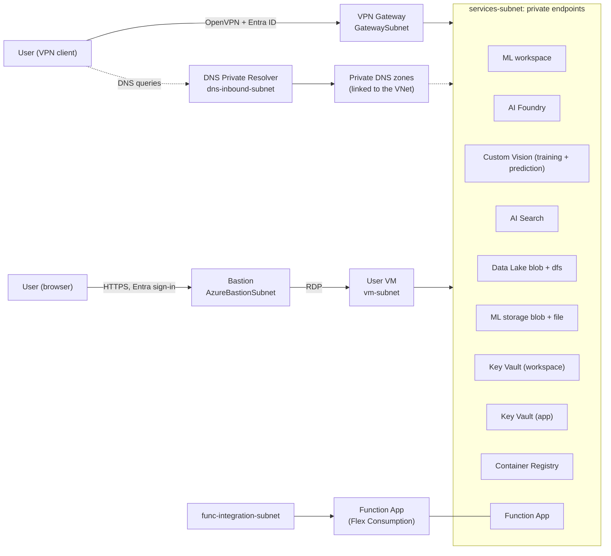

# Architecture

A private-only Azure environment for an AI engineering team. Every PaaS service has public network access disabled. Users reach them either over a Point-to-Site VPN with Microsoft Entra ID authentication, where names resolve to private IPs through an Azure DNS Private Resolver, or through Azure Bastion into VMs inside the network. `ACCESS_MODE` chooses VPN, Bastion or both. See [accessing-the-environment.md](accessing-the-environment.md).

Environment-specific values (resource names, private IPs, portal links, VPN profile) are not listed here. Run `./scripts/deploy.ps1 -Step 6` to print them.

## Overview

The VPN path exists with `ACCESS_MODE` `vpn` or `both`, and the Bastion path with `bastion` or `both`.

## Services and private connectivity

| Service | Private endpoint sub-resource | Private DNS zone(s) |
|---|---|---|
| Azure Machine Learning workspace | `amlworkspace` | `privatelink.api.azureml.ms`, `privatelink.notebooks.azure.net` |
| AI Foundry (AI Services / Azure OpenAI, including Document Intelligence) | `account` | `privatelink.openai.azure.com`, `privatelink.cognitiveservices.azure.com`, `privatelink.services.ai.azure.com` |
| AI Search | `searchService` | `privatelink.search.windows.net` |
| Custom Vision, training and prediction (two accounts) | `account` | `privatelink.cognitiveservices.azure.com` |
| Data Lake (ADLS Gen2) | `blob`, `dfs` | `privatelink.blob.core.windows.net`, `privatelink.dfs.core.windows.net` |
| ML default storage (also holds the Function deployment package) | `blob`, `file` | `privatelink.blob.core.windows.net`, `privatelink.file.core.windows.net` |
| Key Vault (ML workspace) | `vault` | `privatelink.vaultcore.azure.net` |
| Key Vault (application and team secrets) | `vault` | `privatelink.vaultcore.azure.net` |
| Container Registry (Premium) | `registry` | `privatelink.azurecr.io` |
| Function App (Flex Consumption) | `sites` | `privatelink.azurewebsites.net` |

Private endpoints give users inside the VNet (including VPN clients and Bastion VMs) a private path into each service. They do not by themselves connect services to each other, so the connections below are configured separately.

## Service-to-service connections

Every service has public access disabled, so a service that calls another one needs a private path and a role on the target. The network paths are created in step 3 and the roles in step 4.

| From | To | Path (step 3) | Roles (step 4) |
|---|---|---|---|
| AI Search (indexers) | Data Lake | Shared private links `spl-lake-blob` (`blob`) and `spl-lake-dfs` (`dfs`) | Search identity: Storage Blob Data Reader on the Data Lake |
| AI Search (embeddings) | AI Foundry | Shared private link `spl-foundry-openai` (`openai_account`) | Search identity: Cognitive Services OpenAI User on the Foundry account |
| AI Search (Foundry skills) | AI Foundry | Shared private link `spl-foundry-models` (`foundry_account`). Only with `SEARCH_SKU="standard"` | Search identity: Cognitive Services User on the Foundry account |
| AI Search (custom skills) | Function App | Shared private link `spl-function` (`sites`). Only with `SEARCH_SKU="standard"` | Not a role: the Function App must authenticate Search itself (for example Entra sign-in on the app), and the skill definition must use Search's identity |
| AI Foundry (document features) | Data Lake | Firewall rule on the Data Lake for the Foundry account. Only with `FOUNDRY_LAKE_ACCESS="true"` (see below) | Foundry identity: Storage Blob Data Contributor on the Data Lake |
| Azure ML jobs and studio | Data Lake | Managed network outbound private endpoints `lake-blob` and `lake-dfs` | ML workspace identity: Storage Blob Data Contributor on the Data Lake |
| Azure ML jobs | AI Foundry and AI Search | Managed network outbound private endpoints `foundry` (`account`) and `search` (`searchService`) | Roles for the compute that runs the job, assigned by you |
| Azure ML (creating the managed private endpoints) | Data Lake, Foundry, Search | Not applicable | ML workspace identity: Azure AI Enterprise Network Connection Approver on each target |
| Function App | Any service | VNet integration (`func-integration-subnet`) reaches the private endpoints directly | Not assigned, because there is no function code. Grant the Function App identity the roles its code needs |

How they work:

- **Shared private links** are outbound private endpoints owned by the Search service. Search creates each one as a pending request, and the target must approve it. Search cannot approve its own request, so `scripts/deploy.ps1` approves the pending connections on the Data Lake, the Foundry account and the Function App after step 3 and waits until every link shows `Approved`. Reruns are safe.
- **Indexers must run in the private environment.** Set `"executionEnvironment": "private"` in each indexer's configuration, otherwise Search may try the multitenant environment, which cannot use the private links.
- **Azure ML managed network.** The outbound rules are defined when the workspace is deployed. Azure creates the matching private endpoints when the managed network is first provisioned, which happens when you create the first compute or run `az ml workspace provision-network`. They bill as private endpoints from then on. The workspace identity approves them with the role above.
- **Search tier.** On `basic` (the default), Search supports private indexers without skillsets and private embedding connections to Foundry (integrated vectorization). It does not support private connections for skillsets with other built-in skills, for custom skills (the Function App), or for the `foundry_account` link, because Basic does not allow private connections for AI enrichment. Those need `SEARCH_SKU="standard"` (S1, about £185 a month at list price). Basic also allows only four distinct link types (the default uses three: `blob`, `dfs` and `openai_account`). The tier cannot be changed in place, so changing `SEARCH_SKU` on a deployed environment means deleting the search service first and rerunning step 3.
- **Function App as a custom skill is unverified.** Microsoft documents shared private links to Function Apps on Consumption, Premium and Dedicated plans, and does not list Flex Consumption, which this repository uses. The `sites` link also needs a preview API version. Test it before relying on it.
- **Document Intelligence runs through the Foundry account.** There is no separate Document Intelligence account. The Foundry (AI Services) account includes it, and it is reached on the same private endpoint, with the same Entra roles (the Foundry User role covers its data actions). That keeps one endpoint and one set of roles, at the cost of sharing the Foundry account's quota with other Foundry workloads. Environments deployed from an earlier version of this repository may still have a `docintel-` account. Nothing here uses it, so delete it and its private endpoint by hand if you do not need it.
- **Foundry and the Data Lake.** The Foundry account cannot create an outbound private link, so the only supported way for its document features to read storage is the "resource instance" firewall exception, which does not work while the storage account's public network access is `Disabled`. With `FOUNDRY_LAKE_ACCESS="true"` the Data Lake's public endpoint is switched to "enabled from selected networks" with the default action `Deny`, no IP or network rules, and a single rule that allows only the Foundry account. Everyone else, including other Azure services, is still denied, and the private endpoints keep working. It is a weaker posture than `Disabled`, and the setting is off by default. It applies to the whole Data Lake, not one container, and it lets the Foundry account's identity read and write it, not only Document Intelligence. Document Intelligence Studio needs the Data Lake reachable from your browser too, which the private endpoint gives you over the VPN or a Bastion VM.
- **Not configured:** Foundry reading from the Data Lake or from Search through its own connections (Azure OpenAI On Your Data was retired on 14 October 2026), and Application Insights (which accepts public ingestion). Add the network path and roles for these when you need them. Custom Vision needs no connections: it keeps its images in its own managed storage and is used through its API.

## Network

| Subnet | Default range | Purpose |
|---|---|---|
| `services-subnet` | `10.0.1.0/24` | Private endpoints |
| `GatewaySubnet` | `10.0.2.0/24` | VPN Gateway only |
| `dns-inbound-subnet` | `10.0.3.0/28` | DNS Private Resolver inbound endpoint (delegated) |
| `func-integration-subnet` | `10.0.4.0/24` | Function App VNet integration (delegated, required by Flex Consumption) |
| `AzureBastionSubnet` | `10.0.5.0/26` | Azure Bastion. Only with `bastion` or `both`. A network security group with the rules Bastion requires is attached |
| `vm-subnet` | `10.0.6.0/24` | The per-user VMs. Only with `bastion` or `both` |

The VNet address space is `10.0.0.0/16`. With VPN access the resolver inbound endpoint uses the first usable address of its subnet (`10.0.3.4`) and is set as the VNet DNS server, so VPN clients receive it in their profile. Ranges are set in `.env`.

## Access layer (step 5)

- **VPN** (`vpn` or `both`): a VPN Gateway (Point-to-Site, OpenVPN, Entra ID sign-in) and a DNS Private Resolver, so a connected computer resolves private names to private addresses.
- **Bastion** (`bastion` or `both`): an Azure Bastion host and one Windows Server 2022 VM per user (`VM_COUNT`). A user opens their VM in the Azure portal, connects through Bastion with the VM's local username and password, and works from there. Each VM has a system-assigned identity with Virtual Machine Contributor on itself only, so it can deallocate itself. Each VM also gets a daily shutdown schedule and an idle shutdown task, and a run command installs Git, Python, VS Code and the Azure CLI. Failures in that run command are logged to `C:\ProvisionTools.log` and never fail the deployment. The installers are downloaded over HTTPS and are not checksum-verified, and the script turns off Internet Explorer's enhanced security mode for administrators so the VMs can browse.

## Two Key Vaults

- **Workspace vault:** used only by the Azure ML workspace for its internal secrets. Only admins get access.
- **Application vault:** for team and application secrets. Developers can read and write. The Function App's managed identity has Key Vault Secrets User, so it can use Key Vault references.

## Design decisions

- **Fourth subnet.** The services, gateway and DNS resolver subnets are not enough. Flex Consumption VNet integration needs its own subnet delegated to `Microsoft.App/environments`, and a private endpoint subnet cannot be shared with it, so `func-integration-subnet` exists.
- **Separate storage for Azure ML.** Azure ML does not support a hierarchical-namespace (Data Lake) account as its default storage, so the workspace uses its own standard account. The Function App's deployment package (`app-package` container) lives there too.
- **AI Foundry uses the AI Services account kind.** It serves both Azure OpenAI and the Foundry APIs. That adds two DNS zones beyond the OpenAI one (`cognitiveservices` and `services.ai`).
- **Custom Vision is a separate pair of accounts.** It is not part of the Foundry account. It needs one account for training (`CustomVision.Training`) and one for prediction (`CustomVision.Prediction`), each with its own endpoint, private endpoint and keys. They reuse the `cognitiveservices` DNS zone and are deployed through `infra/modules/cognitive-account.bicep`.
- **Custom Vision is being retired.** Microsoft will support it until 25 September 2028 and recommends Azure ML AutoML or Foundry models for new work. It is included for teams that still use it.
- **Extra DNS zones.** `privatelink.notebooks.azure.net` (ML notebooks) and `privatelink.file.core.windows.net` (ML storage file share) are required by Azure ML.
- **Azure ML network mode.** The workspace uses a managed network in `AllowInternetOutbound` mode. Public access to the workspace itself is disabled.
- **Resolver as VNet DNS.** With VPN access, the DNS Private Resolver inbound endpoint is a static address and is also set as the VNet DNS server, so VPN clients receive it in their profile. Step 5 deploys step 1 a second time to set it.
- **AI Search tier.** Search is deployed as `basic` by default, the cheapest tier that supports private endpoints, and `standard` (S1) is available through `SEARCH_SKU`. See [Service-to-service connections](#service-to-service-connections) for what each tier can reach privately. An existing search service cannot change SKU in place, so changing the tier later means recreating it.
- **Names.** Every name follows `<type>-<purpose>-<prefix>`, with a hash suffix derived from the resource group ID only where Azure needs a globally unique name. They are stable across redeployments. See [deployment.md](deployment.md#naming) and `infra/names.bicep`.
- **Shared workload identity.** Step 4 creates a user-assigned identity, `id-workloads-<prefix>`, and adds it to the developers group, so anything it is assigned to has developer access. It lets people create compute clusters and other resources without granting roles each time. It is deliberately lenient: every resource using it gets all developer roles, which is more than most workloads need. For stricter setups use one identity per workload with only the roles it needs. See [rbac.md](rbac.md#workload-identity).
- **Subscription-added resources.** Some subscriptions add resources through Azure Policy or Defender, for example empty network security groups on subnets and Event Grid system topics on storage accounts. They are not created by these templates and have no custom rules.

## Security baseline

- Public network access disabled on every PaaS service.
- Storage: shared key access off, blob public access off, TLS 1.2 minimum.
- Key Vault: RBAC authorization, soft delete, purge protection.
- AI Services and AI Search: key authentication disabled (Entra ID only).
- Custom Vision: key authentication is left on, because Entra support for its API was not verified. Public network access is still disabled, so keys only work from inside the network.
- Container Registry: admin user off.
- Function App: HTTPS only, identity-based storage access.
- Azure ML: system-assigned identity, identity-based datastores.
- Access is granted to Entra groups. See [rbac.md](rbac.md).
- Bastion VMs: local password per VM (generated, 24 characters), so there is no MFA at the VM sign-in. Each VM can manage only itself.

## Not included

- Model deployments and Foundry projects.
- Foundry connections to the Data Lake and to Search.
- Custom network security group rules on the service subnets. Only the Bastion subnet has an NSG from these templates. Empty NSGs on other subnets, if any, come from the subscription.
- Azure Monitor Private Link Scope (Application Insights accepts public ingestion).

## Deployment order

| Step | File | Contents |
|---|---|---|
| 1 | `infra/01-network.bicep` | VNet, subnets, private DNS zones and links |
| 2 | `infra/02-storage-keyvault.bicep` | Data Lake, both Key Vaults, private endpoints |
| 3 | `infra/03-ai-ml.bicep` | Container Registry, Search, AI Foundry, Azure ML, Function App, private endpoints, Search shared private links and Azure ML outbound rules (approved by the script) |
| 4 | `infra/04-rbac.bicep` | Entra groups, role assignments for the groups, and roles for the Search and ML workspace identities |
| 5 | `infra/05-access-vpn.bicep`, `infra/05-access-bastion.bicep` | Access layer chosen by `ACCESS_MODE`. VPN: DNS Private Resolver and VPN Gateway, then step 1 again to set VNet DNS. Bastion: step 1 again to add the Bastion and VM subnets, then Bastion and the VMs |
| 6 | (script) | Summary: portal links, private endpoint IPs, connection details for the chosen access mode |

See [README.md](../README.md) for how to run them and [vpn-client-setup.md](vpn-client-setup.md) for connecting.
